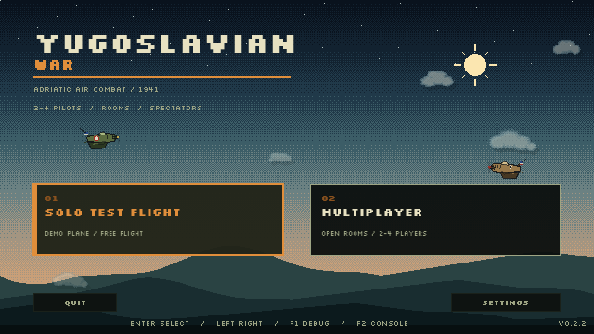
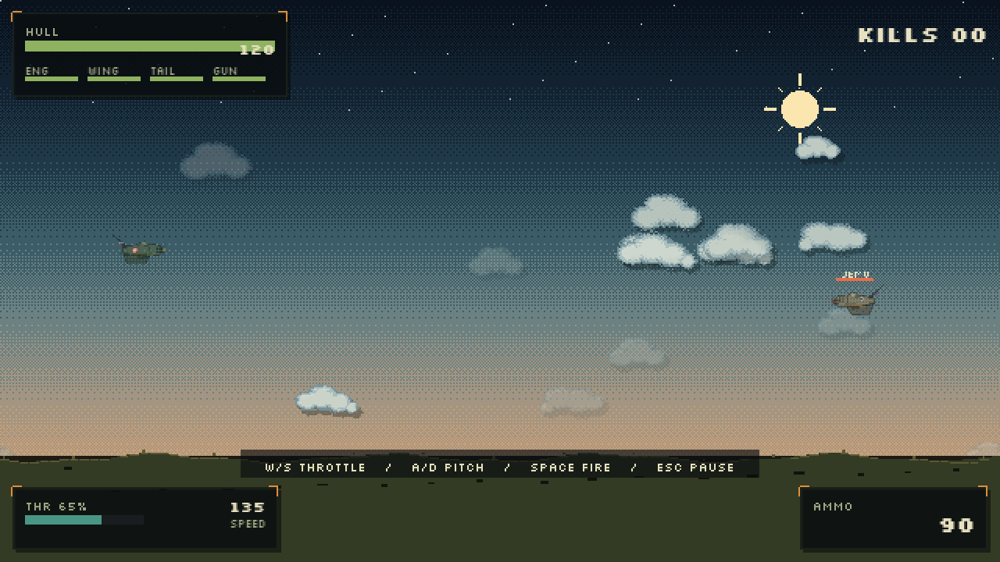
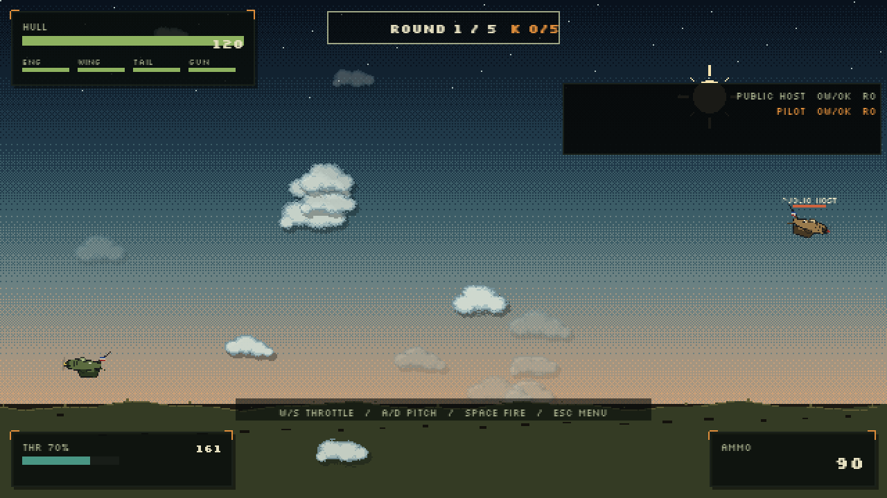
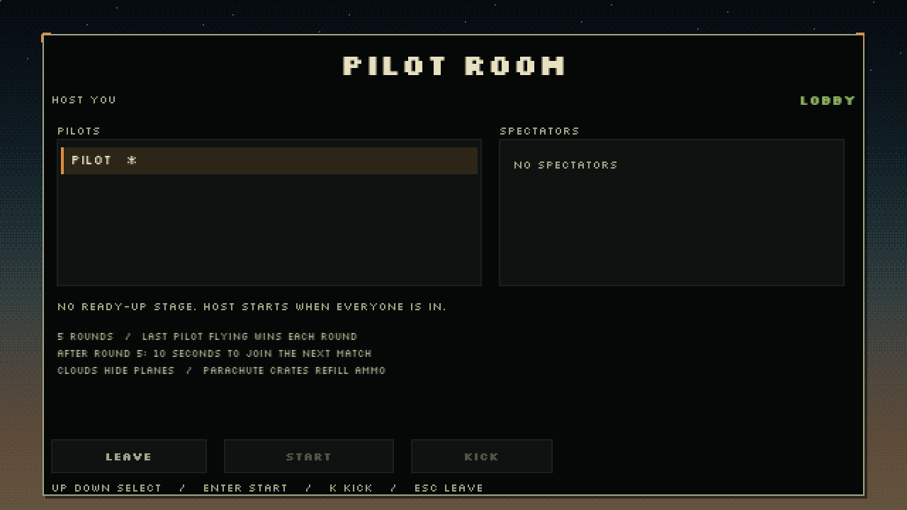
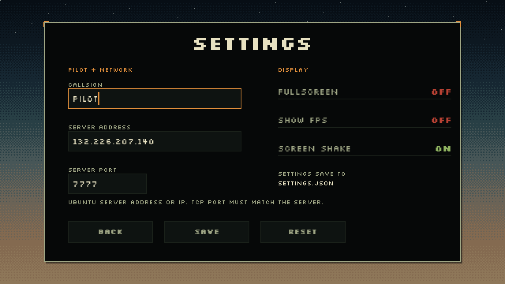

# Yugoslavian War

**A lightweight WW2 side-view dogfight game for 2–4 pilots, with a solo test flight, a dedicated Ubuntu server and pixel-art aircraft drawn entirely in code.**

[**Download the latest Windows build**](https://github.com/stefanovic000/Yugoslavian-War/releases/latest)



## About

Yugoslavian War is a small, fast LÖVE 11.5 game set over the Adriatic in 1941.
The player aircraft is a stylised Yugoslav low-wing monoplane inspired by the
Rogožarski IK-3: olive drab, a Yugoslav roundel on the fuselage and the
red-white-blue tail flash. The opposing aircraft carries a Balkan cross.

Everything — aircraft, clouds, terrain, trails, particles and UI — is drawn
procedurally. There are no large art packs and no runtime downloads.

## Features

- **Solo test flight** against a demo AI that manages throttle, energy and stall recovery.
- **Online rooms** for 2–4 pilots: create, join, spectate and start without a ready-up step.
- **Kill-scored matches**: first to 5 kills wins a round, 5 rounds per match, then a full reset.
- **3-second respawns** for every pilot, solo and online.
- **Low ground** at the bottom of the arena. Touch it and the aircraft explodes and respawns.
- **Cloud cover** that actually hides aircraft. Cloud positions and per-plane visibility are server-authoritative.
- **Energy flight model**: thrust along the nose, gravity, lift, drag, turn drag and engine braking.
- **Modular damage**: engine, wing, tail and guns each have their own health and affect flight.
- **Parachute ammo crates**, swept hitboxes and a fixed 60 Hz simulation.
- **Host kick with room ban**, room browser, spectator slots and a 10-second next-match prep.
- **Settings**: callsign, server address/port, fullscreen, FPS counter and screen shake.
- **Debug toolkit**: console, live watches, hitbox/cloud debug draw, profiler, screenshots and crash reports.

## Screenshots

### Solo test flight



### Multiplayer match



### Room lobby



### Settings



## Controls

| Input | Action |
| --- | --- |
| `W` / `S` | Increase / decrease throttle |
| `A` / `D` | Pitch. `A` rotates counter-clockwise and `D` clockwise relative to the aircraft: facing right `A` is up and `D` down; facing left `D` is up and `A` down. The newest direction stays active until released. |
| `Space` | Fire (full auto) |
| `Esc` | Pause in solo / leave menu in multiplayer |
| `F1` | Debug HUD |
| `F2` | Developer console |
| `F3` | Hitbox, cloud and velocity debug draw |
| `F4` | Profiler |
| `F5` | Reload current scene (blocked during a live match) |
| `F6` / `F7` / `F8` | Debug pause / step / slow motion |
| `F9` | Screenshot |
| `F11` | Fullscreen |

## Download and run

The Windows release includes the fused executable and the required LÖVE DLLs:

1. Download `Yugoslavian-War-Windows.zip` from the [latest release](https://github.com/stefanovic000/Yugoslavian-War/releases/latest).
2. Extract the whole folder — do not move the `.exe` away from its DLLs.
3. Run **Yugoslavian War.exe**.

The client starts with:

```text
Server: 132.226.207.140
Port:   7777
```

The address is editable in **Settings**; an old `127.0.0.1` setting is migrated
to the public server automatically. Press **RESET** in Settings if an older
copy of the game still shows localhost.

## Multiplayer

1. Open **MULTIPLAYER**.
2. Create a room, or select an open room and press **ENTER**.
3. The host presses **START** when 2–4 pilots are in.
4. Started rooms remain listed; joining one puts you in as a spectator.
5. After round 5, spectators have 10 seconds to join the next match.

Kicks are issued in the lobby with **KICK** or `K`. A kicked player is banned
from that room for its lifetime.

## Dedicated server

The server is authoritative for flight, damage, bullets, clouds, respawns and
round scores. It is a standalone Lua 5.1 + LuaSocket program and does not need
LÖVE.

The deployed server lives entirely in:

```text
/home/ubuntu/Yugoslavian-planes
```

Run it in the foreground:

```bash
cd /home/ubuntu/Yugoslavian-planes
lua5.1 server/run.lua --port=7777
```

Or manage it with the included systemd unit:

```bash
sudo ln -sf /home/ubuntu/Yugoslavian-planes/server/yugoslavian-war.service \
  /etc/systemd/system/yugoslavian-war.service
sudo systemctl daemon-reload
sudo systemctl enable --now yugoslavian-war
journalctl -u yugoslavian-war -f
```

Server requirements: `lua5.1` and `lua-socket`. The full install, firewall,
systemd hardening and security notes are in
[server/README.md](server/README.md).

The authoritative TCP port is **7777**. On the current Oracle VPS the local
firewall accepts 7777 before its default reject rule, and Oracle ingress is
configured for TCP 7777.

## Flight and combat

- **Flight model:** thrust along the nose, gravity, quadratic drag, lift based
  on speed and wing health, sideslip drag, turn drag and engine braking.
- **Energy matters:** hard turns bleed speed and a stall drops the nose. There
  is no free vertical climb.
- **Top speed:** roughly 170 world units/s, capped so dives cannot spike.
- **Damage:** 120 hull, with separate engine, wing, tail and gun health.
- **Clouds:** server-generated puffs; the server sends their positions and each
  plane's `hidden` flag in snapshots. The client never decides visibility alone.
- **Ground:** a low strip at `y = 365`; contact is a crash, not a kill. The
  aircraft explodes and starts a respawn.
- **Arena:** 800×450 world units rendered at 0.8× into a 640×360 pixel viewport.
  Horizontal wrap, bounded vertical space, fixed 60 Hz simulation.

## Development

Requirements: LÖVE 11.5. The portable runtime is restored with:

```powershell
powershell -ExecutionPolicy Bypass -File tools\fetch-love.ps1
```

Run from the project root:

```bat
run.bat
```

Server mode on Windows:

```bat
run.bat --server --port=7777
```

### Tests

```bat
test.bat        :: 36 unit tests (flight, hitboxes, clouds, rounds, protocol)
smoke.bat       :: boot, solo flight, commands, console and screenshots
```

Network integration (server must be running):

```bash
python tests/server_integration.py
```

UI test:

```bat
lovec . --uitest --nohud
```

### Building the Windows release

The release executable is a fused LÖVE build with a plane icon and version
string. Runtime DLLs must stay beside it. The build artifact is produced under
`build/`, which is intentionally excluded from git.

## Project layout

```text
main.lua / conf.lua        client boot and window config
shared/                    deterministic flight, combat, clouds, AI, rounds
server/                    LuaSocket authoritative server + systemd unit
src/game/                  sky, ground, sprites, particles, settings
src/scenes/                menu, solo, browser/lobby, netmatch, settings
src/net/client.lua         non-blocking TCP/JSON client
src/core/                  log, debug console/HUD, profiler, crash handler
src/ui/ui.lua              pixel UI toolkit
tests/                     unit tests, server integration, UI test hook
tools/love/                portable LÖVE 11.5 runtime (gitignored)
tools/fetch-love.ps1       restores the runtime
docs/                      screenshots and debugging guide
```

## Third-party

- **LÖVE 11.5** — zlib/libpng license, `tools/love/license.txt`.
- **Silkscreen** and **Space Mono** — SIL Open Font License; files in `assets/fonts/`.
- **lib/json.lua** — MIT; see `lib/json-LICENSE.txt`.

## Status

Version **0.2.2**. The game is in active playtesting: flight feel, network
visibility, respawns and room lifecycle are the current focus.
